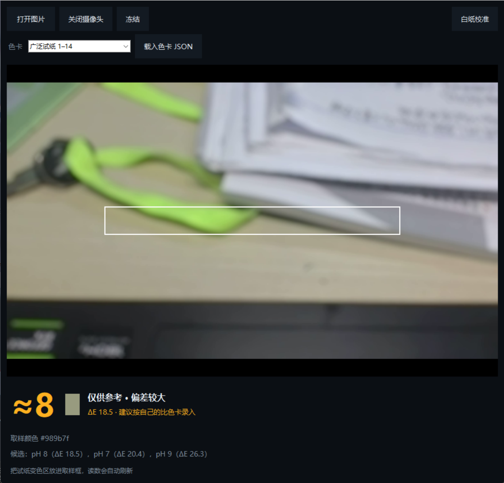

# pH 试纸读数

用手机摄像头对着 pH 试纸的变色区，自动比对色卡并给出 pH 值。

包含 **Android App** 和 **Python 桌面版**，两端共用同一套取色与色差算法，色卡 JSON 格式互通。



## 下载 / 在线使用

- **Android 安装包**：[Releases](https://github.com/fffffff1024/ph-strip-reader/releases/latest) 里下载 `ph-strip-reader-1.0.0.apk`（Android 7.0 及以上）
- **网页版**（免安装，手机浏览器直接打开）：https://fffffff1024.github.io/ph-strip-reader/
- **Python 桌面版**：见下方「Python 版」

## 功能

- **实时取色**：取景框内的颜色实时分析，约每秒 8 次刷新
- **色差匹配**：sRGB → CIELAB(D65) → CIEDE2000，比直接比 RGB 距离准得多
- **白纸校准**：用白纸做白平衡参考，抵消灯光偏色
- **自定义色卡**：任何品牌的试纸，拍下包装上的比色卡即可录入；每个色块的 pH 都能单独改
- **记录与导出**：测量记录存在本地，可导出 CSV；色卡可导出/导入 JSON
- **相册选图**：从相册选一张照片分析，不必实时对焦

## 目录结构

```
ph-strip-app/
├─ docs/                    Android 版的界面与逻辑（打包进 APK 的 assets）
│                          同时是 GitHub Pages 的发布目录
│  ├─ index.html
│  ├─ style.css
│  └─ app.js                取色、色差、色卡匹配
├─ app/                     Android 外壳（Kotlin）
│  └─ src/main/java/com/example/phstrip/MainActivity.kt
├─ python/
│  └─ ph_strip.py           Python 桌面版（同一套算法）
├─ build.gradle.kts
├─ settings.gradle.kts
└─ gradle.properties
```

## Android 版

外壳是 Kotlin（负责摄像头权限、相册选图、把网页装进 WebView），业务逻辑是 JavaScript。
这样改算法不用重新编译，浏览器里也能直接调试。

### 编译

需要 Android SDK（platform 37、build-tools 36.0.0）和 JDK 17+。

```bash
./gradlew assembleDebug
```

产物：`app/build/outputs/apk/debug/app-debug.apk`

### 本地预览网页部分

```bash
python -m http.server 8080 --directory docs
```

浏览器打开 http://127.0.0.1:8080 ，没有摄像头时可以点提示选一张照片。

## Python 版

```bash
pip install pillow numpy opencv-python   # opencv 只用于摄像头
python python/ph_strip.py                # 图形界面
```

命令行：

```bash
# 分析一张照片，取样框按图片宽高的比例给：x,y,宽,高
python python/ph_strip.py 照片.jpg --rect 0.2,0.45,0.6,0.1

# 用自定义色卡，输出 JSON
python python/ph_strip.py 照片.jpg --chart 色卡.json --json
```

## 算法

1. 取景框内逐像素取样
2. 各通道取中值，再剔除离群点（距中值 50 以上）后求均值 —— 避免边缘和阴影干扰
3. 按白纸校准得到的增益做白平衡
4. sRGB → 线性 → XYZ(D65) → CIELAB
5. 与色卡每一项算 CIEDE2000 色差，取最小值
6. ΔE ≤ 15 报读数，> 15 显示 `≈pH` 并标注"仅供参考"

色差算法的实现用 [Sharma 等人（2005）](http://www2.ece.rochester.edu/~gsharma/ciede2000/) 的标准测试数据校验过，7 组全部吻合。

## 精度与限制

- 手机拍照受光线影响很大，同一张试纸在不同光下颜色能差一档。做到 ±0.5 个 pH 单位是现实的，想更准必须固定光源（固定台灯 + 固定距离）。
- 内置的「广泛试纸 1–14」只是通用近似色。**正式使用前必须按自己试纸包装上的比色卡录入一套**，否则读数和色卡对不上。
- 这工具适合日常粗测（水质、土壤等），**不能替代实验室仪器，不要用于医疗判断**。

## 许可

[MIT License](LICENSE)
